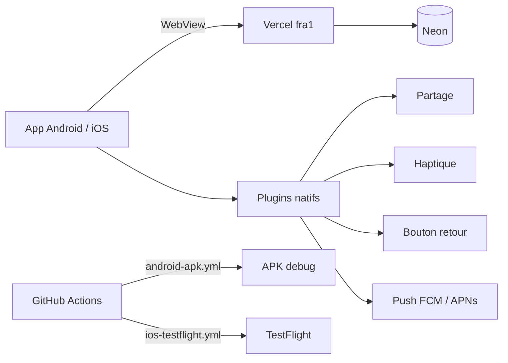

# Application native (Android + iOS) — Capacitor

L'app est une **coque native** (Capacitor) qui charge le site déployé sur Vercel (`server.url` dans `capacitor.config.ts`). Un seul code web ; aucune mise à jour de store n'est nécessaire pour changer le contenu. `appId` : `com.epomta.app` (modifiable avant la première publication, puis figé).



## Ce qui est en place

| Élément | État |
|---|---|
| Capacitor 8 (core, android, ios, splash-screen, status-bar, push-notifications, share, app, browser, haptics) | Installé |
| Projets `android/` et `ios/` générés et versionnés | Oui |
| Icônes + splash (Android et iOS) depuis le « E » doré sur bleu nuit (`resources/`, `@capacitor/assets`) | Générés |
| Page hors ligne (`native-www/offline.html`, `server.errorPath`) FR/EN | Oui |
| Bouton retour Android, haptique léger, barre d'état, splash (`NativeBridge`) | Oui |
| Partage natif d'une œuvre (`ShareButton`, fiche œuvre) | Oui (aussi Web Share sur le web) |
| APK debug | **Non construit ici** (pas de JDK/SDK) → workflow `android-apk.yml` |
| Build iOS | Impossible sans Mac → workflow `ios-testflight.yml` |
| Push natives (FCM/APNs) | **À configurer** (voir plus bas) ; la PWA garde Web Push |
| Google OAuth dans la WebView | Google refuse OAuth dans une WebView intégrée : à tester ; sinon masquer « Continuer avec Google » dans l'app ou passer par `@capacitor/browser` |

Non testé : aucun test sur appareil réel n'a été possible (ni émulateur Android, ni iPhone).

## Commandes

```bash
npm run build            # site web (inchangé)
npx cap sync             # recopie la config et les plugins dans android/ et ios/
npx cap open android     # ouvre Android Studio
npx capacitor-assets generate --android --ios   # régénère icônes/splash depuis resources/
```

Pour tester un site local depuis un téléphone, remplacer temporairement `server.url` par `http://<IP-du-PC>:3111` et `cleartext: true`.

## Installer l'APK sur un téléphone Android (pas à pas)

1. Sur GitHub : onglet **Actions** → workflow **Android APK debug** → **Run workflow** (≈ 5 min).
2. Ouvrir l'exécution terminée → télécharger l'artefact **epomta-debug-apk** (zip) → extraire `app-debug.apk`.
3. Envoyer le fichier sur le téléphone (câble, Drive, e-mail).
4. Sur le téléphone : ouvrir le fichier ; si demandé, autoriser « Installer des applications inconnues » pour l'application utilisée (Fichiers/Chrome).
5. Installer puis ouvrir **E póm ta’**. Le mot de passe d'accès à la démo s'affiche comme sur le site.

Alternative locale : installer Android Studio (inclut JDK + SDK), `npx cap open android`, puis *Build > Build APK(s)*.

## iOS : compiler et envoyer à TestFlight

Pré-requis (à créer par vous) :
- Compte **Apple Developer Program** (99 €/an) — https://developer.apple.com/programs/
- App créée dans **App Store Connect** avec l'identifiant de bundle `com.epomta.app` (ajouter la capability *Push Notifications*).
- **Certificat de distribution** (Apple Distribution, `.p12` + mot de passe) et **profil de provisioning** App Store pour `com.epomta.app`. Sans Mac : générables depuis le portail développeur (CSR créé avec OpenSSL).
- **Clé API App Store Connect** (`.p8`, Key ID, Issuer ID).

Secrets GitHub à créer (Settings > Secrets and variables > Actions) — **noms uniquement** :

| Secret | Contenu |
|---|---|
| `APPLE_TEAM_ID` | Identifiant d'équipe Apple (10 caractères) |
| `IOS_CERTIFICATE_P12_BASE64` | Certificat de distribution `.p12` encodé en base64 |
| `IOS_CERTIFICATE_PASSWORD` | Mot de passe du `.p12` |
| `IOS_PROVISIONING_PROFILE_BASE64` | Profil `.mobileprovision` encodé en base64 |
| `IOS_PROVISIONING_PROFILE_NAME` | Nom du profil dans le portail Apple |
| `KEYCHAIN_PASSWORD` | Mot de passe quelconque du trousseau temporaire |
| `APP_STORE_CONNECT_KEY_ID` | Key ID de la clé API |
| `APP_STORE_CONNECT_ISSUER_ID` | Issuer ID |
| `APP_STORE_CONNECT_KEY_P8_BASE64` | Clé `.p8` encodée en base64 |

Lancer ensuite **Actions > iOS TestFlight > Run workflow** ; le build apparaît dans TestFlight après traitement Apple (≈ 15 min). Alternative sans YAML : **Codemagic** (offre gratuite limitée) avec les mêmes éléments.

## Notifications push natives

Le site utilise déjà Web Push (VAPID). Pour des push **natives** dans l'app :
- **Android** : créer un projet Firebase, ajouter l'app `com.epomta.app`, placer `google-services.json` dans `android/app/` (non versionné), activer FCM.
- **iOS** : créer une clé **APNs** (.p8) dans le portail Apple et la téléverser dans Firebase (Cloud Messaging), ajouter `GoogleService-Info.plist`.
- Côté code : enregistrer le jeton avec `@capacitor/push-notifications` et l'envoyer à une route serveur (table de jetons à ajouter, migration) ; ajouter l'envoi FCM à `/api/alerts/run`. **Non implémenté dans ce lot** (dépend des comptes ci-dessus).

## App Store (guideline 4.2) et Google Play

Apple refuse les « simples sites web emballés ». Éléments natifs présents : partage natif, haptique, bouton retour, splash, page hors ligne, barre d'état. À renforcer avant soumission : push natives, widget/raccourcis éventuels, et une valeur d'usage claire (favoris, alertes, Miroir caméra). Prévoir un compte de démonstration pour les relecteurs et le mot de passe d'accès de la démo dans les notes de revue.

### Fiche de store (brouillon)

| Champ | FR | EN |
|---|---|---|
| Nom | E póm ta’ | E póm ta’ |
| Sous-titre (30 car.) | L'art afrodescendant | Afrodescendant art |
| Description courte (80 car.) | Peintres, sculpteurs, photographes et créateurs de mode afrodescendants. | Afrodescendant painters, sculptors, photographers and fashion designers. |
| Description longue | E póm ta’ (« Tu es très belle » en ghomálá’) est une vitrine digitale de l'art afrodescendant : découvrez les œuvres, rencontrez les artistes, essayez les pièces avec le Miroir, enregistrez vos favoris et recevez des alertes. | E póm ta’ (“You are very beautiful” in Ghomálá’) is a digital showcase of afrodescendant art: discover artworks, meet the artists, try pieces with the Mirror, save favourites and get alerts. |
| Mots-clés (iOS, 100 car.) | art africain,afrodescendant,peinture,sculpture,photographie,mode,artiste,galerie,Cameroun | african art,afrodescendant,painting,sculpture,photography,fashion,artist,gallery,Cameroon |
| Catégorie | Shopping (principale), Style de vie | Shopping (primary), Lifestyle |
| Classification | 4+ / PEGI 3 | 4+ / PEGI 3 |

### Captures à fournir

- iPhone 6,9" (1290×2796) : 3 à 10 captures — accueil, fiche œuvre, fiche artiste, Miroir, favoris, panier.
- iPhone 6,5" (1284×2778) si demandé ; iPad 13" (2064×2752) si l'app est universelle.
- Android téléphone : 2 à 8 captures 1080×1920 minimum ; **icône 512×512** et **image de présentation 1024×500** (Google Play).

### Checklist de soumission

Apple : compte Developer actif · app App Store Connect créée · URL de politique de confidentialité (`/fr/support/privacy`) · questionnaire « confidentialité des données » · classification d'âge · captures · compte de démo + mot de passe d'accès pour la revue · build TestFlight validé · notes de revue (fonctions natives).

Google : compte Play Console (25 $ une fois) · fiche + captures + icône 512 + bannière 1024×500 · politique de confidentialité · formulaire « Sécurité des données » · classification du contenu · AAB signé (`bundleRelease` + clé d'upload) · test fermé (12 testeurs pendant 14 jours pour les comptes personnels récents).

**Rien n'est publié sans votre accord explicite.**

## Ce que vous devez fournir ou créer

1. Compte Apple Developer (99 €/an) + accès à App Store Connect.
2. Compte Google Play Console (25 $) ; un téléphone Android pour tester.
3. Un iPhone pour TestFlight (installer l'app TestFlight).
4. Décision finale sur l'`appId` (`com.epomta.app`) et le nom de l'éditeur.
5. Projet Firebase (push natives) : `google-services.json`, clé APNs.
6. Secrets GitHub listés ci-dessus.
7. Nom de domaine final (recommandé avant publication : remplacer `server.url` par le domaine définitif).
8. Responsable de traitement et coordonnées pour la politique de confidentialité.
