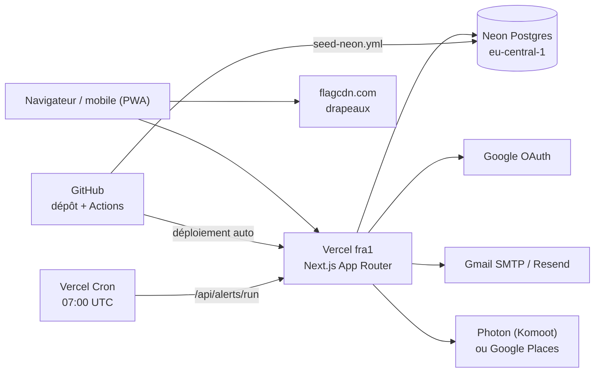
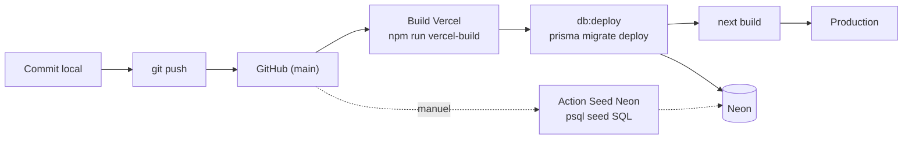
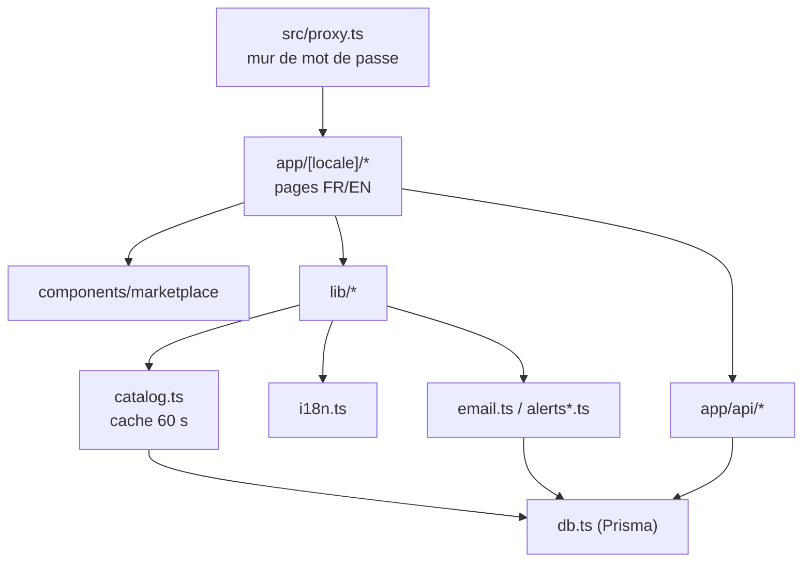

# Architecture — E póm ta’ (démonstration privée)

Document de référence sur l'architecture technique : hébergement, base, déploiement, application, variables d'environnement, limites et feuille de route. Il ne contient aucune valeur secrète. Pour les étapes pas à pas, voir [DEPLOIEMENT.md](./DEPLOIEMENT.md).

## 1. Vue d'ensemble

| Brique | Rôle | Source dans le dépôt |
|---|---|---|
| Vercel | Hébergement Next.js, région `fra1`, cron quotidien | `vercel.json` |
| Neon | PostgreSQL managé (Frankfurt, `eu-central-1`, décision utilisateur) | `prisma/schema.prisma` (`provider = "postgresql"`) |
| GitHub | Code, branche `main`, workflow manuel de seed | `.github/workflows/seed-neon.yml` |
| Google OAuth | Connexion sociale (Facebook/Apple prévus, « Bientôt » sans clés) | `src/lib/social-providers.ts` |
| Gmail SMTP / Resend | E-mails de commande et d'alertes (Resend prioritaire si configuré) | `src/lib/email.ts` |
| Photon / Google Places | Saisie guidée des adresses | `src/lib/address-provider.ts` |
| flagcdn.com | Images de drapeaux (sélecteur région) | `src/components/marketplace/flag.tsx` |

## 2. Déploiement

- `npm run vercel-build` = `node scripts/db.mjs deploy && next build` : applique les migrations puis construit. `postinstall` génère le client Prisma. `DIRECT_URL` (connexion Neon non poolée) est utilisée par `db:deploy` si elle existe, sinon `DATABASE_URL`.
- Variables : définies dans Vercel › Settings › Environment Variables (voir § 5).
- Le workflow `Seed Neon` (déclenchement manuel) charge `prisma/seed.neon.sql` via le secret GitHub `NEON_DATABASE_URL`, avec l'option d'ajouter/retirer les pièces d'exemple du Miroir.
- Remotes git (constat, sans secret) : `origin` en *fetch* = `github.com/patrickyamdjeu/afrique-marketplace`, en *push* = `git@github.com:yamdjeup/africa-marketplace.git`. Les deux URL diffèrent : vérifier avec `git remote -v` avant de pousser, et garder en tête que Vercel déploie le dépôt qui lui est connecté.
- Les données et le projet sont sur offres gratuites (Vercel Hobby, Neon free) : démarrages à froid possibles.

## 3. Application

- **Routes** (`src/app/[locale]/`) : accueil, `catalogue`, `produits/[slug]`, `createurs`, `boutique/**` (navigation mobile), `cart`, `checkout`, `account`, `favoris`, `alertes`, `login`, `register`, `support`, `design`. API (`src/app/api/`) : `alerts`, `auth`, `catalog` (comptage Affiner + options), `favorites`.
- **i18n** : dictionnaires FR/EN dans `src/lib/i18n.ts` ; contenu UI en français, anglais en second ; pays/région dans `src/lib/region.ts`.
- **Données** : Prisma. Modèles : `Category`, `Creator`, `Product`, `User` (préférences d'alertes `alertFavorites`, `alertPromo`, `promoSince`), `Favorite`, `Address`, `Order`, `OrderItem`. Migrations `0001_init` → `0007_alerts` (init, comptes, galerie, catalogue lot A, adresses, carnet d'adresses, alertes). Sans `DATABASE_URL`, le développement local utilise une base SQLite dérivée du schéma par `scripts/db.mjs` (ne pas lancer `prisma generate` directement).
- **Authentification** : Auth.js (`next-auth` v5 beta), comptes e-mail/mot de passe (`bcryptjs`) et Google si `AUTH_GOOGLE_*` renseignés.
- **Panier / commandes** : panier côté client (`src/lib/cart.tsx`), commandes en base, e-mail de confirmation (`order-email.ts`, `email.ts`), statuts dans `order-status.ts`.
- **Favoris et alertes** : favoris en localStorage, synchronisés en base pour les comptes connectés (`/api/favorites`). Alertes : baisse de prix, dernière pièce, retour en stock, nouvelles pièces ; lien de désinscription signé HMAC-SHA256 (`alerts-core.ts`) ; exécution par `/api/alerts/run` (cron Vercel `0 7 * * *`, protégé par `CRON_SECRET`).
- **Mur de mot de passe** : `src/proxy.ts` + `src/lib/site-access.ts` (cookie `site_access` signé, 30 jours) ; désactivé si `SITE_ACCESS_PASSWORD` est vide ; `robots.txt` interdit tout et `noindex` partout.
- **PWA / AR / Miroir / vidéos** : `src/app/manifest.ts` (manifeste installable) ; AR via `@google/model-viewer`, Miroir caméra via `@mediapipe/tasks-vision` ; vidéos d'artistes dans `public/videos/` (non commitées).
- **Cache** : `unstable_cache` 60 s sur `getCategories`, `getCategoryMenu`, `getCategoryShowcase`, `getFilterOptions` (données identiques pour tous) ; pas de cache sur favoris, panier, compte, alertes. Une modification en base peut mettre jusqu'à 60 s à apparaître.
- **Performance** : région `fra1` proche de Neon, requêtes Prisma indépendantes en `Promise.all`, squelettes `loading.tsx` sur `/boutique` et `/catalogue`.

## 4. Environnement et exécution

Le build Vercel utilise `vercel-build`. Les pages sont rendues à la demande (aucun accès base pendant le build).

## 5. Variables d'environnement

Source : `.env.example` (aucune valeur dans le dépôt). Local : `.env.local` (ignoré par git). Production : Vercel › Settings › Environment Variables.

| Nom | Rôle | Obligatoire ? |
|---|---|---|
| `DATABASE_URL` | Connexion PostgreSQL Neon (poolée) ; absente en local = SQLite | Oui en production |
| `DIRECT_URL` | Connexion Neon directe, utilisée par `db:deploy` | Optionnelle |
| `AUTH_SECRET` | Secret de session Auth.js | Oui en production |
| `AUTH_URL` | URL publique du site | Oui en production |
| `AUTH_GOOGLE_ID` / `AUTH_GOOGLE_SECRET` | Connexion Google | Optionnelles (sinon bouton « Bientôt ») |
| `AUTH_FACEBOOK_ID` / `_SECRET`, `AUTH_APPLE_ID` / `_SECRET` | Connexion Facebook / Apple | Optionnelles |
| `SITE_ACCESS_PASSWORD` | Mot de passe d'entrée de la démo (vide = mur désactivé) | Recommandée en démo privée |
| `SITE_ACCESS_SECRET` | Clé de signature du cookie d'accès | Oui si mur actif |
| `GMAIL_USER` / `GMAIL_APP_PASSWORD` | E-mails via Gmail SMTP | Optionnelles (sans elles, aucun e-mail) |
| `RESEND_API_KEY` / `EMAIL_FROM` | E-mails via Resend (prioritaire sur Gmail) | Optionnelles |
| `GOOGLE_PLACES_API_KEY` | Adresses via Google Places (sinon Photon) | Optionnelle |
| `CRON_SECRET` | Autorise `/api/alerts/run` (envoyé par Vercel Cron) | Oui pour les alertes |
| Secret GitHub `NEON_DATABASE_URL` | Utilisé par le workflow Seed Neon | Si seed via GitHub Actions |

## 6. Limites connues et dette technique

- Drapeaux servis par `flagcdn.com` (CDN tiers, requiert Internet).
- Photon (OpenStreetMap/Komoot) : service public sans SLA.
- Gmail SMTP : environ 500 e-mails/jour ; Resend nécessite un domaine vérifié.
- Notifications push non implémentées (pas de service worker ; option « Bientôt »).
- Préférences de magasin (« Mes préférences boutique ») simulées en localStorage.
- Coordonnées de contact et textes « provisoire » à remplacer ; visuels d'artistes/marques réels = démonstration privée uniquement.
- Vercel Hobby : démarrages à froid ; cache 60 s non invalidé à la demande.
- Images servies sans l'optimiseur `/_next/image` (derrière le mur de mot de passe).

### Feuille de route vers la production

1. Domaine dédié `epomta.com` : achat via OVH, puis rattachement à Vercel (Connect External Domain).
2. Sauvegardes Neon (point-in-time restore / exports planifiés).
3. Resend avec domaine vérifié.
4. Service worker et notifications push.
5. Dépôt de marque (INPI / EUIPO).
6. Remplacer les contenus provisoires et les visuels sous droits.

## 7. Travailler sur le projet

- Installation : `npm install` (génère le client Prisma). Base locale : `npm run db:setup`, puis `npm run db:seed`.
- Développement : `npm run dev -- -p 3111` (sous Windows : `npm.cmd`, avec `NODE_OPTIONS=--use-system-ca`).
- Contrôles : `npx tsc --noEmit`, `npm run lint`, `npm run build`.
- Tests : `npm run test:e2e` (Playwright ; ports 3100 et 3101 pour le test du mur).
- Base : `db:check` (valide schéma et migrations), `db:deploy`, `db:studio`, `db:examples-add` / `db:examples-remove` (pièces d'exemple du Miroir).
- Règle : un lot = un commit court et atomique ; décisions importantes consignées dans [HISTORY.md](./HISTORY.md) ; pas de `git push` sans accord explicite.
